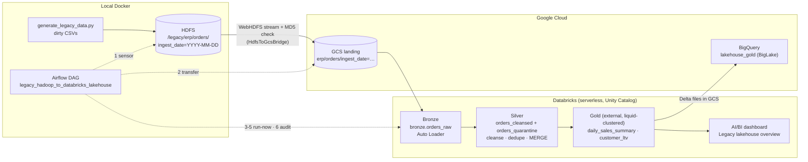

# Hadoop-to-Lakehouse

End-to-end migration of partitioned legacy ERP data from **Hadoop HDFS** to a **Databricks lakehouse on GCP**:

HDFS → Google Cloud Storage → Bronze / Silver / Gold Delta tables (Databricks, Unity Catalog) → BigQuery,
orchestrated by **Apache Airflow**.

HDFS and Airflow run locally in Docker to save trial credits. GCS, Databricks (serverless) and BigQuery are
the real cloud services. The full specification is in [`SPEC.md`](SPEC.md), transcribed from `spec.docx`, with
implementation notes on every deviation.

**Dashboard:** [lakehouse.praponb.com](https://lakehouse.praponb.com) shows the migration step by step, from the
HDFS files to the Gold tables, with numbers from the latest run.

## Project overview

### The scenario

A company keeps its ERP order history on an on-premises **Hadoop** cluster: every day a batch job dumps that day's
orders into HDFS as CSV files, one folder per day. The dumps are messy (duplicates, missing customer IDs, mixed
timestamp formats, late status changes, and a new column that appears one day). The company wants that data in a
cloud **lakehouse** where it is cleaned once, kept as reliable tables, and queried by both data engineers
(Databricks) and analysts (BigQuery), without switching the legacy system off on day one.

This project builds that migration path as a daily pipeline: each day's HDFS folder is copied to Google Cloud,
refined by Databricks into Bronze → Silver → Gold Delta tables, and exposed to BigQuery, with Airflow running the
steps in order and checking the result.

### How each technology is used

| Technology | Where it runs | What it does in this project |
|---|---|---|
| **Hadoop HDFS** 3.2.1 | Local Docker: one NameNode + one DataNode (`bde2020` images, replication 1) | Plays the legacy source system. Generated CSVs are loaded under `/legacy/erp/orders/ingest_date=YYYY-MM-DD/`. Nothing in the pipeline uses Hadoop compute (no MapReduce, Hive or YARN): HDFS is only read, over its **WebHDFS** REST API on port 9870. |
| **Apache Airflow** 2.10 | Local Docker (LocalExecutor + Postgres) | The orchestrator. One daily DAG waits for the day's HDFS folder, copies it to GCS, triggers the three Databricks steps and audits row counts. |
| **Google Cloud Storage** | GCP project `moukda-lakehouse`, `asia-southeast1` | Two buckets. **Landing** receives the raw CSVs copied from HDFS. **Lakehouse** holds everything Databricks writes: the Delta files of every table, Auto Loader's schema and checkpoint folders, and the Gold tables that BigQuery reads. |
| **GCP IAM** | Same project | Three identities, each with only the access it needs (see below). No identity has project-wide admin roles. |
| **Databricks on GCP** | Databricks workspace in GCP, serverless compute | The processing engine. PySpark jobs build the medallion layers; **Unity Catalog** governs the tables and their GCS locations; **Auto Loader** picks up new landing files; a **SQL warehouse** serves the audit and the dashboard; an **Asset Bundle** deploys the job and the dashboard from this repo. |
| **Delta Lake** | Files in the lakehouse bucket | The table format for every layer: ACID writes, `MERGE` for upserts, schema evolution, and liquid clustering on Gold. |
| **BigQuery** | Same GCP project | Analysts' SQL access to Gold. BigLake tables read the Gold Delta files in place through a `CLOUD_RESOURCE` connection, so no data is copied and each Gold rebuild is visible immediately. |
| **AI/BI dashboard** | Databricks | "Legacy lakehouse overview": a Sales page over Gold and a Data quality page over Bronze and Silver. |

### One day's data, end to end

1. **Generate and load (Hadoop).** `generate_legacy_data.py` writes about 10,000 dirty order rows for a date;
   `load_to_hdfs.sh` copies it into the NameNode container and replaces that date's HDFS folder with `hdfs dfs -put`.
2. **Wait for the data (Airflow → Hadoop).** `verify_hdfs_partition` calls WebHDFS `LISTSTATUS` until the folder
   for `{{ ds }}` exists.
3. **Copy to the cloud (Hadoop → GCP).** `distcp_hdfs_to_gcs` streams each file from WebHDFS straight into a GCS
   resumable upload in 8 MiB chunks, without touching local disk, and fails if the MD5 that GCS computes differs
   from the bytes read from HDFS.
4. **Bronze (Databricks).** Auto Loader ingests only files it has not seen before, infers the column types, and
   tags each row with its source file and `batch_date`. A new column stops the stream once; the job's retry
   picks up the evolved schema.
5. **Silver (Databricks).** Rows are typed and cleaned. Rows that break a rule go to `orders_quarantine` with the
   reasons; valid rows are deduplicated to the latest `updated_at` and `MERGE`d into `orders_cleansed`.
6. **Gold (Databricks).** `daily_sales_summary` and `customer_ltv` are rebuilt from Silver and written as external
   Delta tables in the lakehouse bucket.
7. **Audit (Airflow → Databricks SQL).** Checks Bronze ≥ Silver + quarantine, no duplicate order IDs in Silver and
   a non-empty Gold for the day.
8. **Query (BigQuery, dashboard).** BigQuery's BigLake tables and the AI/BI dashboard read the new Gold straight away.

Every step can be re-run for the same date without duplicating data, which is what makes daily reruns and
backfills safe.

### What was created on GCP and Databricks

| Resource | Purpose |
|---|---|
| GCP project `moukda-lakehouse` (`asia-southeast1`) | Holds the buckets, BigQuery and the IAM identities |
| `gs://moukda-lakehouse-landing` | Raw CSVs from HDFS, under `erp/orders/ingest_date=…/` |
| `gs://moukda-lakehouse-uc` | Unity Catalog storage: managed Bronze and Silver tables, external Gold tables, Auto Loader state |
| Service account `airflow-lakehouse` | Airflow's identity for the copy step: `storage.objectAdmin` on the landing bucket only |
| Databricks storage credential `lakehouse_gcs_cred` | A Databricks-managed GCP service account with read/write on both buckets, used through the external locations `landing_zone` and `lakehouse_zone` |
| BigQuery connection `biglake_gcs` + dataset `lakehouse_gold` | The connection's service account has `storage.objectViewer` on the lakehouse bucket only; the dataset holds the BigLake tables over Gold |
| Unity Catalog catalog `legacy_migration_cat` | Schemas `bronze`, `silver`, `gold` |
| Bundle job `legacy_medallion`, SQL warehouse, AI/BI dashboard | Processing, the audit query and the dashboard |

## Status

Every requirement in the spec is implemented and was run against the live services:

- Four batch days (2026-10-14, -15, -16 and -18), including the day-2 schema change (a new `discount_code` column)
  and a second schema change on 2026-10-16 (`sales_channel`) recovered by the Bronze task's retry
- Idempotent re-runs: re-running a date leaves every table's fingerprint unchanged
- BigQuery totals that match Databricks Gold exactly
- Airflow DAG runs from the HDFS sensor through to the row-count audit, both with `airflow dags test` and through
  the scheduler
- The AI/BI dashboard over Gold, Bronze and Silver
- 52 local tests passing

The cloud resources were torn down on 2026-10-20 at the end of the trial, following
[`trial-end-cleanup.md`](trial-end-cleanup.md). **They were rebuilt on 2026-10-21** from this repo (see
[Getting started](#getting-started)), without BigQuery. Four days of mock data (2026-10-14 to 2026-10-17) ran
through the Airflow DAG, so the AI/BI dashboard has data again. The same numbers are published at
[lakehouse.praponb.com](https://lakehouse.praponb.com) (see [`site/`](site/)). The work log is in
[`pending-item.md`](pending-item.md), where every item is closed.

## Architecture



### The DAG

`legacy_hadoop_to_databricks_lakehouse`, scheduled `@daily` with `catchup=False`:

| # | Task | What it does |
|---|---|---|
| 1 | `verify_hdfs_partition` | `HttpSensor` on WebHDFS `LISTSTATUS` for `ingest_date={{ ds }}` |
| 2 | `distcp_hdfs_to_gcs` | Streams the partition to the landing bucket and checks each file's MD5 against GCS |
| 3 | `run_databricks_bronze` | Triggers the bundle job with only `bronze_ingest`, `batch_date={{ ds }}` |
| 4 | `run_databricks_silver` | Triggers the bundle job with only `silver_upsert` |
| 5 | `run_databricks_gold` | Triggers the bundle job with only `gold_aggregate` |
| 6 | `audit_row_counts` | On the SQL warehouse, checks Bronze ≥ Silver + Quarantine, no duplicate keys and non-empty Gold |

The Databricks steps use `DatabricksRunNowOperator` on the deployed Asset Bundle job, so the DAG and
`databricks bundle run` share one definition: serverless compute, script paths and Bronze's retries.

### Medallion layers

| Layer | Table(s) | Key behaviour |
|---|---|---|
| Bronze | `legacy_migration_cat.bronze.orders_raw` | Auto Loader CSV, `addNewColumns` schema evolution, `availableNow` trigger; adds `_ingest_timestamp`, `_source_file`, `batch_date` |
| Silver | `silver.orders_cleansed`, `silver.orders_quarantine` | Multi-format timestamp parsing, type enforcement, data-quality split with `error_reason`, latest-`updated_at` dedupe, `MERGE … WHEN MATCHED AND source.updated_at > target.updated_at` |
| Gold | `gold.daily_sales_summary`, `gold.customer_ltv` | Full rebuild with `INSERT OVERWRITE`; liquid clustering; external tables at `gs://…-uc/gold/<table>` that BigQuery reads |

**Idempotency.** Auto Loader's checkpoint skips files it has already ingested. The quarantine is replaced per
`batch_date` rather than appended to, the MERGE never overwrites a newer version, and Gold is rebuilt in full.

## Repository layout

| Path | Purpose |
|---|---|
| `docker-compose.yml`, `hadoop.env` | Single-node HDFS (bde2020 Hadoop 3.2.1) plus Airflow 2.10.2 (LocalExecutor, Postgres) |
| `Dockerfile.airflow`, `requirements.txt` | Airflow image with the Databricks, Google and HTTP providers, `hdfs`, `pyspark==3.5.3`, `delta-spark` |
| `Makefile` | Shortcuts for the venv, tests, Docker, seeding and the bundle |
| `hadoop_seed/generate_legacy_data.py` | Generator for dirty legacy orders (stdlib only) |
| `hadoop_seed/load_to_hdfs.sh` | Loads generated partitions into HDFS, replacing each partition |
| `airflow/plugins/hdfs_to_gcs_transfer.py` | `HdfsToGcsBridge`: streams from WebHDFS to GCS and returns a manifest (`files_transferred`, `total_bytes`, `md5_hashes`) |
| `airflow/dags/hadoop_to_lakehouse_dag.py` | The DAG |
| `databricks/databricks.yml` | Asset Bundle: job `legacy_medallion`, `bronze_ingest → silver_upsert → gold_aggregate`, serverless with `STANDARD` performance target; dashboard `lakehouse_overview` |
| `databricks/dashboards/lakehouse_overview.lvdash.json` | AI/BI dashboard: a Sales page over Gold and a Data quality page over Bronze and Silver |
| `databricks/setup_uc.sql` | Unity Catalog setup: external locations, catalog, schemas, Silver and Gold tables |
| `databricks/src/` | `bronze_autoloader.py`, `silver_transform.py`, `gold_aggregations.py`, `common/spark_session.py` |
| `bigquery/create_biglake_tables.sql` | BigLake `DELTA_LAKE` tables over Gold |
| `site/` | Public dashboard at lakehouse.praponb.com: `public/index.html` (d3 page), `public/data.json` (numbers snapshot), `snapshot.py` (refreshes the snapshot from the Airflow logs, HDFS, GCS and the SQL warehouse), `wrangler.jsonc` (Cloudflare Worker) |
| `tests/` | Local pytest suite: generator, Silver, Gold, transfer bridge (with fakes) and DAG integrity |
| `SPEC.md` · `spec.docx` | Specification and implementation notes |
| `pending-item.md` · `trial-end-cleanup.md` | Open items and teardown checklist |

### Generated test data

`generate_legacy_data.py --date YYYY-MM-DD --rows N [--evolve-schema]` writes
`ingest_date=YYYY-MM-DD/orders_part_<n>.csv` with these anomalies:

- 5% duplicate `order_id`s: half are exact re-dumps, half are status updates
- ~2% null or malformed `customer_id`s
- Two timestamp formats mixed together
- Status updates that progress PENDING/PAID → SHIPPED → CANCELLED
- Late-arriving updates (including cancellations) to the previous day's orders
- Non-positive quantities, negative prices, and messy SKU and status casing
- A `discount_code` column when `--evolve-schema` is set

## Getting started

### Prerequisites

- Docker Desktop. The Hadoop images are amd64-only, so they run under emulation on Apple silicon.
- Python 3.11 and [`uv`](https://github.com/astral-sh/uv), because PySpark 3.5 doesn't support Python 3.13 or later. `make venv` uses `/opt/homebrew/bin/python3.11`; override it with `PYTHON_BIN=`. Also Java 17 for the local Spark tests.
- `gcloud`/`bq`, and the Databricks CLI (tested with v1.20)
- A GCP project, and a Databricks-on-GCP workspace with Unity Catalog, serverless jobs and a SQL warehouse

### 1. Local: tests, HDFS and Airflow (free)

```bash
cp .env.example .env            # fill in values; see Configuration
make venv                       # .venv with Python 3.11 (PySpark, Airflow, providers)
make test                       # 52 tests: generator, Silver, Gold, bridge, DAG
make up                         # HDFS on :9870, Airflow on :8080 (airflow / airflow)
make seed load-hdfs DATE=2026-10-14
make seed load-hdfs DATE=2026-10-15 EVOLVE=1   # day 2 adds discount_code
make hdfs-ls
```

### 2. Cloud setup (once)

1. **GCS:** create the landing and lakehouse buckets in your region, with uniform access and public access prevention.
2. **Service account for Airflow:** grant `roles/storage.objectAdmin` on the landing bucket and save its key as
   `config/gcp-service-account.json` (git-ignored).
3. **Unity Catalog:** create a GCP storage credential named `lakehouse_gcs_cred`:
   ```bash
   databricks storage-credentials create --json '{"name": "lakehouse_gcs_cred", "databricks_gcp_service_account": {}}'
   ```
   Then grant its generated service account `roles/storage.objectAdmin` and `roles/storage.legacyBucketReader` on
   both buckets, and run [`databricks/setup_uc.sql`](databricks/setup_uc.sql) on the SQL warehouse.
4. **Bundle:** `make bundle-validate` and `make bundle-deploy`. These use the CLI profile in
   `DATABRICKS_PROFILE`, `databricksgcp` by default. Put the deployed job's ID in `.env` as `DATABRICKS_JOB_ID`,
   then run `docker compose up -d` to reload Airflow. The deploy also publishes the AI/BI dashboard
   "Legacy lakehouse overview", which runs on the SQL warehouse in the bundle's `warehouse_id` variable.
5. **BigQuery:** create a `CLOUD_RESOURCE` connection, grant its service account `roles/storage.objectViewer` on the
   lakehouse bucket, then run [`bigquery/create_biglake_tables.sql`](bigquery/create_biglake_tables.sql).

The bucket names, project and workspace host in `setup_uc.sql`, `create_biglake_tables.sql` and
`databricks.yml` are this project's values. Replace them with your own.

### 3. Run the pipeline

```bash
# Through Airflow, for one date, with the DAG left paused
docker compose exec airflow-scheduler airflow dags test legacy_hadoop_to_databricks_lakehouse 2026-10-14

# Or the Databricks part only (the files must already be in the landing bucket)
cd databricks && databricks bundle run -t dev legacy_medallion --profile databricksgcp --params batch_date=2026-10-14
```

Unpausing the DAG makes the scheduler create a run for the latest daily interval straight away, so make sure
that date's partition exists in HDFS first.

## Configuration (`.env`)

| Key | Used by | Purpose |
|---|---|---|
| `GCP_PROJECT_ID` | DAG | Project for the GCS client |
| `GCS_LANDING_BUCKET` / `GCS_LAKEHOUSE_BUCKET` | DAG, jobs | `gs://` landing and lakehouse buckets |
| `GOOGLE_APPLICATION_CREDENTIALS` | Airflow containers | Path to the mounted service account key (fixed in `docker-compose.yml`) |
| `HDFS_NAMENODE_HOST` / `HDFS_WEBHDFS_PORT` / `HDFS_SOURCE_PATH` | DAG, loader, compose | WebHDFS endpoint and source path |
| `DATABRICKS_HOST` / `DATABRICKS_TOKEN` | Airflow `databricks_default` connection | Workspace and personal access token |
| `DATABRICKS_CATALOG` | DAG, jobs | Unity Catalog catalog (`legacy_migration_cat`) |
| `DATABRICKS_JOB_ID` | DAG | ID of the deployed bundle job |
| `DATABRICKS_WAREHOUSE_ID` | DAG audit | SQL warehouse for the row-count audit |
| `AIRFLOW_UID` | compose | Container user |

Airflow connections come from `AIRFLOW_CONN_*` variables in `docker-compose.yml`. Secrets live only in
`.env` and `config/`, which are both git-ignored.

## Make targets

| Target | Does |
|---|---|
| `venv` / `test` | Build the 3.11 venv / run pytest |
| `compile` | `py_compile` every module and `bash -n` the loader |
| `config` / `up` / `down` / `logs` | Docker Compose shortcuts |
| `seed` / `load-hdfs` / `hdfs-ls` | Generate a day (`DATE=`, `ROWS=`, `EVOLVE=1`), load it into HDFS, list HDFS |
| `bundle-validate` / `bundle-deploy` | Databricks Asset Bundle, using `DATABRICKS_PROFILE` |
| `clean` | Remove generated data and local Spark artefacts |

## Design notes

These are explained in full in the [`SPEC.md` implementation notes](SPEC.md#implementation-notes).

- **Serverless instead of a cluster.** The job uses a serverless environment (Python 3.11) with `performance_target: STANDARD`.
  `bronze_ingest` has `max_retries: 2`, because Auto Loader stops once when a new column appears.
- **BigQuery compatibility.** Gold tables turn off deletion vectors and use `delta.checkpointPolicy = 'classic'`.
  Databricks enables v2 checkpoints by default on liquid-clustered tables, and BigQuery's Delta reader rejects them.
- **Extra quality rules.** Rows with malformed customer IDs, unparseable values or unknown statuses are quarantined too, with every failed rule listed.
- **`customer_ltv`** is clustered by `customer_id`, because it has no `order_date` or `product_sku` columns.

## Cost and cleanup

While deployed, nothing runs on its own: the DAG is paused and the bundle job has no schedule, so the only
ongoing costs are GCS storage and the SQL warehouse while the dashboard or the audit queries it. To tear
everything down, follow [`trial-end-cleanup.md`](trial-end-cleanup.md) in order. This project's resources were
removed that way on 2026-10-20, then rebuilt on 2026-10-21.

The page at lakehouse.praponb.com is a static Cloudflare Worker on the free plan. It serves a saved snapshot,
so it keeps working after a teardown. To update it after new runs:

```bash
python3 site/snapshot.py <dir with the run_YYYY-MM-DD.log files from airflow dags test>
cd site && npx wrangler@4.20.0 deploy
```
