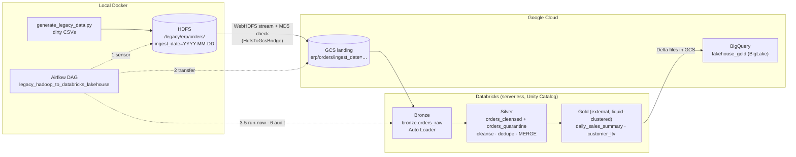

# Hadoop-to-Lakehouse

End-to-end migration of partitioned legacy ERP data from **Hadoop HDFS** to a **Databricks lakehouse on GCP**:

HDFS → Google Cloud Storage → Bronze / Silver / Gold Delta tables (Databricks, Unity Catalog) → BigQuery,
orchestrated by **Apache Airflow**.

HDFS and Airflow run locally in Docker to save trial credits. GCS, Databricks (serverless) and BigQuery are
the real cloud services. The full specification is in [`SPEC.md`](SPEC.md), transcribed from `spec.docx`, with
implementation notes on every deviation.

## Status

Every requirement in the spec is implemented and has been run against the live services:

- Two batch days, including the day-2 schema change (a new `discount_code` column)
- Idempotent re-runs: re-running a date leaves every table's fingerprint unchanged
- BigQuery totals that match Databricks Gold exactly
- A full Airflow DAG run, from the HDFS sensor through to the row-count audit
- 52 local tests passing

Open items are tracked in [`pending-item.md`](pending-item.md), and teardown steps in [`trial-end-cleanup.md`](trial-end-cleanup.md).

## Architecture



### The DAG

`legacy_hadoop_to_databricks_lakehouse`, scheduled `@daily` with `catchup=False`:

| # | Task | What it does |
|---|---|---|
| 1 | `verify_hdfs_partition` | `HttpSensor` on WebHDFS `LISTSTATUS` for `ingest_date={{ ds }}` |
| 2 | `distcp_hdfs_to_gcs` | Streams the partition to the landing bucket and checks each file's MD5 against GCS |
| 3 | `run_databricks_bronze` | Triggers the bundle job with only `bronze_ingest`, `batch_date={{ ds }}` |
| 4 | `run_databricks_silver` | Triggers the bundle job with only `silver_upsert` |
| 5 | `run_databricks_gold` | Triggers the bundle job with only `gold_aggregate` |
| 6 | `audit_row_counts` | On the SQL warehouse, checks Bronze ≥ Silver + Quarantine, no duplicate keys and non-empty Gold |

The Databricks steps use `DatabricksRunNowOperator` on the deployed Asset Bundle job, so the DAG and
`databricks bundle run` share one definition: serverless compute, script paths and Bronze's retries.

### Medallion layers

| Layer | Table(s) | Key behaviour |
|---|---|---|
| Bronze | `legacy_migration_cat.bronze.orders_raw` | Auto Loader CSV, `addNewColumns` schema evolution, `availableNow` trigger; adds `_ingest_timestamp`, `_source_file`, `batch_date` |
| Silver | `silver.orders_cleansed`, `silver.orders_quarantine` | Multi-format timestamp parsing, type enforcement, data-quality split with `error_reason`, latest-`updated_at` dedupe, `MERGE … WHEN MATCHED AND source.updated_at > target.updated_at` |
| Gold | `gold.daily_sales_summary`, `gold.customer_ltv` | Full rebuild with `INSERT OVERWRITE`; liquid clustering; external tables at `gs://…-uc/gold/<table>` that BigQuery reads |

**Idempotency.** Auto Loader's checkpoint skips files it has already ingested. The quarantine is replaced per
`batch_date` rather than appended to, the MERGE never overwrites a newer version, and Gold is rebuilt in full.

## Repository layout

| Path | Purpose |
|---|---|
| `docker-compose.yml`, `hadoop.env` | Single-node HDFS (bde2020 Hadoop 3.2.1) plus Airflow 2.10.2 (LocalExecutor, Postgres) |
| `Dockerfile.airflow`, `requirements.txt` | Airflow image with the Databricks, Google and HTTP providers, `hdfs`, `pyspark==3.5.3`, `delta-spark` |
| `Makefile` | Shortcuts for the venv, tests, Docker, seeding and the bundle |
| `hadoop_seed/generate_legacy_data.py` | Generator for dirty legacy orders (stdlib only) |
| `hadoop_seed/load_to_hdfs.sh` | Loads generated partitions into HDFS, replacing each partition |
| `airflow/plugins/hdfs_to_gcs_transfer.py` | `HdfsToGcsBridge`: streams from WebHDFS to GCS and returns a manifest (`files_transferred`, `total_bytes`, `md5_hashes`) |
| `airflow/dags/hadoop_to_lakehouse_dag.py` | The DAG |
| `databricks/databricks.yml` | Asset Bundle: job `legacy_medallion`, `bronze_ingest → silver_upsert → gold_aggregate`, serverless with `STANDARD` performance target |
| `databricks/setup_uc.sql` | Unity Catalog setup: external locations, catalog, schemas, Silver and Gold tables |
| `databricks/src/` | `bronze_autoloader.py`, `silver_transform.py`, `gold_aggregations.py`, `common/spark_session.py` |
| `bigquery/create_biglake_tables.sql` | BigLake `DELTA_LAKE` tables over Gold |
| `tests/` | Local pytest suite: generator, Silver, Gold, transfer bridge (with fakes) and DAG integrity |
| `SPEC.md` · `spec.docx` | Specification and implementation notes |
| `pending-item.md` · `trial-end-cleanup.md` | Open items and teardown checklist |

### Generated test data

`generate_legacy_data.py --date YYYY-MM-DD --rows N [--evolve-schema]` writes
`ingest_date=YYYY-MM-DD/orders_part_<n>.csv` with these anomalies:

- 5% duplicate `order_id`s: half are exact re-dumps, half are status updates
- ~2% null or malformed `customer_id`s
- Two timestamp formats mixed together
- Status updates that progress PENDING/PAID → SHIPPED → CANCELLED
- Late-arriving updates (including cancellations) to the previous day's orders
- Non-positive quantities, negative prices, and messy SKU and status casing
- A `discount_code` column when `--evolve-schema` is set

## Getting started

### Prerequisites

- Docker Desktop. The Hadoop images are amd64-only, so they run under emulation on Apple silicon.
- Python 3.11 and [`uv`](https://github.com/astral-sh/uv), because PySpark 3.5 doesn't support Python 3.13 or later. `make venv` uses `/opt/homebrew/bin/python3.11`; override it with `PYTHON_BIN=`. Also Java 17 for the local Spark tests.
- `gcloud`/`bq`, and the Databricks CLI (tested with v1.20)
- A GCP project, and a Databricks-on-GCP workspace with Unity Catalog, serverless jobs and a SQL warehouse

### 1. Local: tests, HDFS and Airflow (free)

```bash
cp .env.example .env            # fill in values; see Configuration
make venv                       # .venv with Python 3.11 (PySpark, Airflow, providers)
make test                       # 52 tests: generator, Silver, Gold, bridge, DAG
make up                         # HDFS on :9870, Airflow on :8080 (airflow / airflow)
make seed load-hdfs DATE=2026-10-14
make seed load-hdfs DATE=2026-10-15 EVOLVE=1   # day 2 adds discount_code
make hdfs-ls
```

### 2. Cloud setup (once)

1. **GCS:** create the landing and lakehouse buckets in your region, with uniform access and public access prevention.
2. **Service account for Airflow:** grant `roles/storage.objectAdmin` on the landing bucket and save its key as
   `config/gcp-service-account.json` (git-ignored).
3. **Unity Catalog:** create a GCP storage credential named `lakehouse_gcs_cred`:
   ```bash
   databricks storage-credentials create --json '{"name": "lakehouse_gcs_cred", "databricks_gcp_service_account": {}}'
   ```
   Then grant its generated service account `roles/storage.objectAdmin` and `roles/storage.legacyBucketReader` on
   both buckets, and run [`databricks/setup_uc.sql`](databricks/setup_uc.sql) on the SQL warehouse.
4. **Bundle:** `make bundle-validate` and `make bundle-deploy`. These use the CLI profile in
   `DATABRICKS_PROFILE`, `databricksgcp` by default. Put the deployed job's ID in `.env` as `DATABRICKS_JOB_ID`,
   then run `docker compose up -d` to reload Airflow.
5. **BigQuery:** create a `CLOUD_RESOURCE` connection, grant its service account `roles/storage.objectViewer` on the
   lakehouse bucket, then run [`bigquery/create_biglake_tables.sql`](bigquery/create_biglake_tables.sql).

The bucket names, project and workspace host in `setup_uc.sql`, `create_biglake_tables.sql` and
`databricks.yml` are this project's values. Replace them with your own.

### 3. Run the pipeline

```bash
# Through Airflow, for one date, with the DAG left paused
docker compose exec airflow-scheduler airflow dags test legacy_hadoop_to_databricks_lakehouse 2026-10-14

# Or the Databricks part only (the files must already be in the landing bucket)
cd databricks && databricks bundle run -t dev legacy_medallion --profile databricksgcp --params batch_date=2026-10-14
```

Unpausing the DAG makes the scheduler create a run for the latest daily interval straight away, so make sure
that date's partition exists in HDFS first.

## Configuration (`.env`)

| Key | Used by | Purpose |
|---|---|---|
| `GCP_PROJECT_ID` | DAG | Project for the GCS client |
| `GCS_LANDING_BUCKET` / `GCS_LAKEHOUSE_BUCKET` | DAG, jobs | `gs://` landing and lakehouse buckets |
| `GOOGLE_APPLICATION_CREDENTIALS` | Airflow containers | Path to the mounted service account key (fixed in `docker-compose.yml`) |
| `HDFS_NAMENODE_HOST` / `HDFS_WEBHDFS_PORT` / `HDFS_SOURCE_PATH` | DAG, loader, compose | WebHDFS endpoint and source path |
| `DATABRICKS_HOST` / `DATABRICKS_TOKEN` | Airflow `databricks_default` connection | Workspace and personal access token |
| `DATABRICKS_CATALOG` | DAG, jobs | Unity Catalog catalog (`legacy_migration_cat`) |
| `DATABRICKS_JOB_ID` | DAG | ID of the deployed bundle job |
| `DATABRICKS_WAREHOUSE_ID` | DAG audit | SQL warehouse for the row-count audit |
| `AIRFLOW_UID` | compose | Container user |
| `GCP_REGION`, `BQ_DATASET`, `BQ_CONNECTION` | *(not read yet)* | Reference values; the SQL files write them out directly |

Airflow connections come from `AIRFLOW_CONN_*` variables in `docker-compose.yml`. Secrets live only in
`.env` and `config/`, which are both git-ignored.

## Make targets

| Target | Does |
|---|---|
| `venv` / `test` | Build the 3.11 venv / run pytest |
| `compile` | `py_compile` every module and `bash -n` the loader |
| `config` / `up` / `down` / `logs` | Docker Compose shortcuts |
| `seed` / `load-hdfs` / `hdfs-ls` | Generate a day (`DATE=`, `ROWS=`, `EVOLVE=1`), load it into HDFS, list HDFS |
| `bundle-validate` / `bundle-deploy` | Databricks Asset Bundle, using `DATABRICKS_PROFILE` |
| `clean` | Remove generated data and local Spark artefacts |

## Design notes

These are explained in full in the [`SPEC.md` implementation notes](SPEC.md#implementation-notes).

- **Serverless instead of a cluster.** The job uses a serverless environment (Python 3.11) with `performance_target: STANDARD`.
  `bronze_ingest` has `max_retries: 2`, because Auto Loader stops once when a new column appears.
- **BigQuery compatibility.** Gold tables turn off deletion vectors and use `delta.checkpointPolicy = 'classic'`.
  Databricks enables v2 checkpoints by default on liquid-clustered tables, and BigQuery's Delta reader rejects them.
- **Extra quality rules.** Rows with malformed customer IDs, unparseable values or unknown statuses are quarantined too, with every failed rule listed.
- **`customer_ltv`** is clustered by `customer_id`, because it has no `order_date` or `product_sku` columns.

## Cost and cleanup

With the DAG paused and the bundle job unscheduled, nothing runs on its own. The only ongoing costs are
GCS storage and the idle local containers. To tear everything down, follow
[`trial-end-cleanup.md`](trial-end-cleanup.md) in order.
